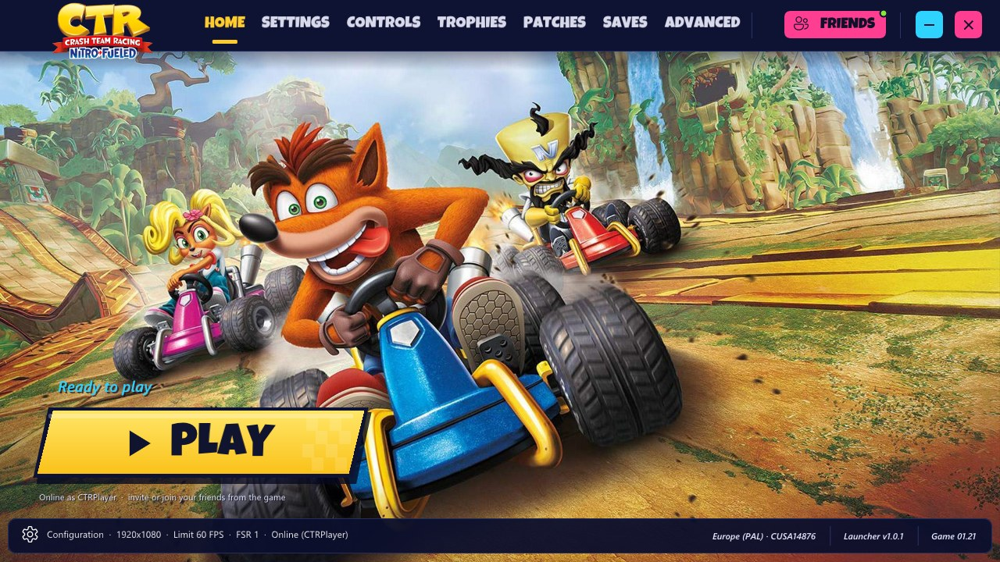
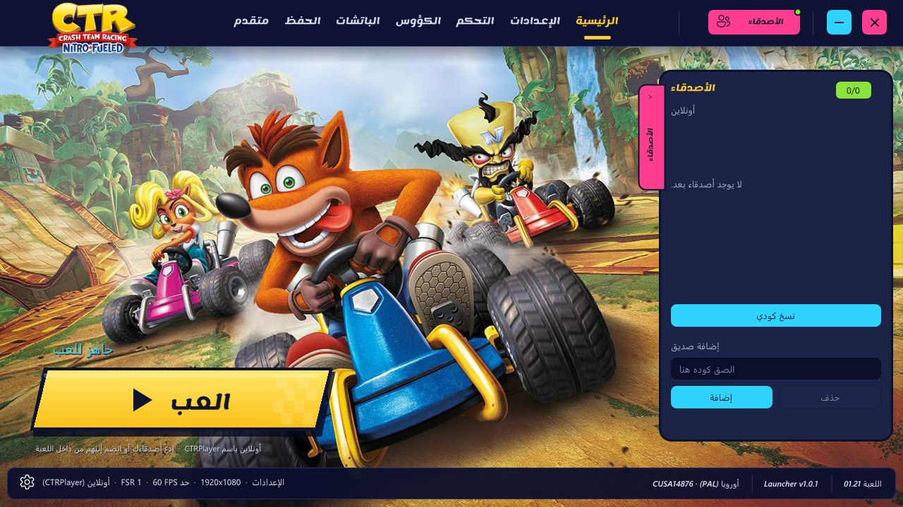

<p align="center">
  
</p>

<h1 align="center">CTR Nitro-Fueled PC — Online Edition</h1>

<p align="center">
  <b>Crash Team Racing Nitro-Fueled (PS4) running natively on Windows, with online play on the RyuNET community server.</b><br>
  <a href="#english">English</a> · <a href="#العربية">العربية</a> ·
  <a href="../../releases/latest"><b>Download / تحميل</b></a>
</p>

<p align="center">
  
  
</p>

> **No game files are included.** You need your own legally obtained PS4 dump of the game and its
> 1.21 update. Not affiliated with or endorsed by Sony Interactive Entertainment, Activision or
> Beenox. *Crash Team Racing*, *Nitro-Fueled* and *PlayStation* are trademarks of their owners.

---

<a id="english"></a>
## English

### What this is

This project joins existing open-source ports of the game, giving full credit to each:

| Project | Author | What it brings here |
|---|---|---|
| [**CTR-NitroFueled-PC**](https://github.com/GetLostIn/CTR-NitroFueled-PC) | [**GetLostIn**](https://github.com/GetLostIn) | The base: the native runtime, the Vulkan renderer, the performance, DLSS / FSR 1 / FSR 3 / FSR 4, frame generation, ultrawide, controllers, patches, saves, DLC, trophies and every launcher feature. |
| [**OCTR-NitroFueled-PC**](https://github.com/Ryu7w7/OCTR-NitroFueled-PC) | [**Ryu7w7**](https://github.com/Ryu7w7) | Online play on the RyuNET community server: the game's network, HTTP, PSN and WebApi functions, public matches, private rooms, friends and invitations, the server tunnel, nicknames kept by a key, and the Pit Stop. |
| [**CTRNativePorted**](https://github.com/guzuold/CTRNativePorted) | [**guzuold**](https://github.com/guzuold) | The "Nitro Cinema" launcher design this launcher follows (its serverless online play was in v1.0). |

The online code runs on CTR-NitroFueled-PC's runtime and renderer, which are unchanged, so the
game keeps that port's performance. With online play off, none of it is used.

### Features

**Performance and graphics** (from CTR-NitroFueled-PC)
- The game's own code runs natively on the CPU; the GPU work goes to Vulkan (shadPS4's renderer).
- Internal resolution from 480p to native 4K; 60 FPS patch, FPS limit up to 240.
- Upscaling: AMD FSR 1, AMD FSR 3.1, AMD FSR 4 (experimental) and NVIDIA DLSS (RTX).
- AMD FSR 3 frame generation (experimental); 21:9 and 32:9 ultrawide with centered HUD.
- Xbox / PlayStation / SDL controllers and keyboard, live controller test, button remapping, split screen.
- Community patches, save backups and imports, optional DLC, the 48 trophies.

**Online** (from OCTR-NitroFueled-PC)
- The RyuNET community server (`octr.ryu7w7.xyz`, or your own): public matches, alone or with your
  group, and private rooms, from the game's own menus.
- Friends by nickname (the launcher's FRIENDS drawer), shown in the game's friends list; invite them
  or join their room.
- Race traffic goes directly between the players' games, with the server's tunnel for players who
  cannot reach each other; the Pit Stop with the server's items or your save's.
- **Compatible with OCTR players** on the same server.
- Sony and Activision servers are never contacted.

**This edition**
- A launcher in the "Nitro Cinema" style: tabs, the Home page with artwork and the big PLAY button,
  the friends drawer, cards for the settings.
- **Arabic and English** interface (technical terms stay in English); Arabic is shaped and laid out
  right to left, with the Lemonada font for titles.
- Replaceable artwork in `assets\launcher`.

### Download and play

1. Download `CTR-NitroFueled-PC-Online-v1.1.0-windows.zip` from
   [Releases](../../releases/latest) and unzip it anywhere.
2. Open **`CTR-NitroFueled-PC.exe`**. In **ADVANCED**, choose your base game folder
   (CUSA14876 Europe or CUSA13795 USA) and your 1.21 update folder, then **Prepare the game**.
3. Press **PLAY**.

**Online:** SETTINGS → *ONLINE & MULTI* → turn on **Multiplayer Online** and choose your own
nickname (the launcher registers it for this PC; `ryunet_online.key` keeps it: never share that
file). Add friends by nickname under **FRIENDS** (top right), then race, invite or join from the
game. Details: [ONLINE.md](packaging/windows/portable/ONLINE.md).

Requirements: Windows 10/11 64-bit, a Vulkan 1.3 GPU, your own decrypted dump with the 1.21 update.

### Building from source

MSYS2 CLANG64, as in [packaging/windows/README.md](packaging/windows/README.md):

```bash
git clone --recursive <this repository>
bash build.sh
python packaging/windows/make_portable.py --version v1.1.0 --name CTR-NitroFueled-PC-Online
```

What this edition adds to the CTR-NitroFueled-PC tree:
- `src/runtime_net*.c`, `runtime_http.c`, `runtime_np_online.c`, `runtime_friends.c` — OCTR's online
  runtime; `src/runtime_ryunet.c` — its system services, bound only when online is on
  (`runtime_net_resolve`); `run.py setup_online` and `patches/CrashTeamRacingOnline*.xml` — the
  nickname, the key and the server's Demonware key.
- `launcher/windows/` — the new launcher (`online.cpp`, the RyuNET client; `arabic.cpp`; the Nitro
  look in `launcher.cpp`).
- `gpu/patches/imgui/` — an optional text-shaping hook for Arabic (unused by the in-game overlay).
- `tools/arabic_presentation_forms.py` — prepares the Arabic font.

The original CTR-NitroFueled-PC README is kept in [docs/UPSTREAM_README.md](docs/UPSTREAM_README.md).

---

<a id="العربية"></a>
<div dir="rtl">

## العربية

### ما هذا المشروع؟

هذا المشروع يجمع بين مشروعين مفتوحَي المصدر للعبة، مع حفظ حقوق صاحبَيهما بالكامل:

| المشروع | صاحبه | ما أُخذ منه |
|---|---|---|
| [**CTR-NitroFueled-PC**](https://github.com/GetLostIn/CTR-NitroFueled-PC) | [**GetLostIn**](https://github.com/GetLostIn) | الأساس كله: تشغيل اللعبة بشكل أصلي، والرندر بـ Vulkan، والأداء الممتاز، و DLSS و FSR 1 و FSR 3 و FSR 4، وتوليد الإطارات، و UltraWide، وأيادي التحكم، والباتشات، والحفظ، و DLC، والكؤوس، وكل ميزات المشغل. |
| [**OCTR-NitroFueled-PC**](https://github.com/Ryu7w7/OCTR-NitroFueled-PC) | [**Ryu7w7**](https://github.com/Ryu7w7) | اللعب الأونلاين على سيرفر RyuNET المجتمعي: دوال الشبكة و HTTP و PSN داخل اللعبة، والسباقات العامة، والغرف الخاصة، والأصدقاء والدعوات، ونفق السيرفر، والأسماء المحفوظة بمفتاح، ومتجر Pit Stop. |
| [**CTRNativePorted**](https://github.com/guzuold/CTRNativePorted) | [**guzuold**](https://github.com/guzuold) | تصميم واجهة "Nitro Cinema" التي تتبعها هذه الواجهة (وكان اللعب الأونلاين بدون سيرفر منه في الإصدار 1.0). |

كود الأونلاين يعمل فوق محرك CTR-NitroFueled-PC دون تغيير المحرك، لذلك تحتفظ اللعبة بنفس الأداء.
وعند إيقاف الأونلاين لا يُستخدم كود الأونلاين أصلاً.

### المزايا

**الأداء والرسوميات** (من CTR-NitroFueled-PC)
- كود اللعبة الأصلي يعمل مباشرة على المعالج، والرسوميات عبر Vulkan (رندر shadPS4).
- دقة داخلية من 480p حتى 4K، وباتش 60 FPS، وحد FPS حتى 240.
- رفع الدقة: AMD FSR 1 و AMD FSR 3.1 و AMD FSR 4 (تجريبي) و NVIDIA DLSS (لكروت RTX).
- توليد الإطارات AMD FSR 3 (تجريبي)، و UltraWide بنسبة 21:9 و 32:9 مع HUD في المنتصف.
- أيادي Xbox و PlayStation و SDL ولوحة المفاتيح، مع تجربة اليد مباشرة وتغيير الأزرار والشاشة المقسومة.
- باتشات المجتمع، ونسخ الحفظ احتياطياً واستيراده، و DLC اختياري، والكؤوس الـ 48.

**الأونلاين** (من OCTR-NitroFueled-PC)
- سيرفر RyuNET المجتمعي (`octr.ryu7w7.xyz` أو سيرفرك الخاص): سباقات عامة وحدك أو مع مجموعتك، وغرف خاصة، من قوائم اللعبة نفسها.
- أضف أصدقاءك باسمهم أونلاين (درج الأصدقاء في المشغل)، وتظهر قائمتهم داخل اللعبة؛ ادعُهم أو انضم إلى غرفتهم.
- بيانات السباق تنتقل مباشرة بين أجهزة اللاعبين، مع نفق السيرفر لمن لا يصلون لبعضهم؛ ومتجر Pit Stop بعناصر السيرفر أو عناصر ملف حفظك.
- **متوافق مع لاعبي OCTR** على نفس السيرفر.
- لا يتم الاتصال أبداً بسيرفرات Sony أو Activision.

**هذه النسخة**
- واجهة بأسلوب "Nitro Cinema": تبويبات، وصفحة رئيسية بخلفية وزر "العب" كبير، ودرج الأصدقاء، وبطاقات للإعدادات.
- **واجهة بالعربية والإنجليزية** (المصطلحات التقنية تبقى بالإنجليزية)، مع تشكيل الحروف والكتابة من اليمين لليسار وخط Lemonada للعناوين.
- الصور قابلة للتغيير من مجلد `assets\launcher`.

### التحميل والتشغيل

1. حمّل الملف `CTR-NitroFueled-PC-Online-v1.1.0-windows.zip` من صفحة [Releases](../../releases/latest) وفك ضغطه في أي مكان.
2. شغّل **`CTR-NitroFueled-PC.exe`**، ومن تبويب **متقدم** اختر مجلد اللعبة الأساسية (CUSA14876 الأوروبية أو CUSA13795 الأمريكية) ومجلد تحديث 1.21، ثم اضغط **تجهيز اللعبة**.
3. اضغط **العب**.

**الأونلاين:** الإعدادات ← بطاقة *الأونلاين واللعب الجماعي* ← فعّل **اللعب الأونلاين** واكتب اسمك الخاص
(يسجّله المشغل لهذا الجهاز، والملف `ryunet_online.key` يحفظه: لا تشاركه أبداً). أضف أصدقاءك بأسمائهم من
**الأصدقاء** (أعلى اليمين)، ثم سابق أو ادعُهم أو انضم إليهم من داخل اللعبة. التفاصيل في [README-AR.txt](packaging/windows/portable/README-AR.txt).

المتطلبات: ويندوز 10 أو 11 (64 بت)، وكرت شاشة يدعم Vulkan 1.3، ونسختك الخاصة من اللعبة مع تحديث 1.21.

</div>

---

## Credits / الشكر والحقوق

This project exists thanks to / هذا المشروع موجود بفضل:

- **[GetLostIn](https://github.com/GetLostIn)** — [CTR-NitroFueled-PC](https://github.com/GetLostIn/CTR-NitroFueled-PC), the Windows port this project is built on (made with Claude, Anthropic).
- **[Ryu7w7](https://github.com/Ryu7w7)** and the OCTR contributors — [OCTR-NitroFueled-PC](https://github.com/Ryu7w7/OCTR-NitroFueled-PC): the online play and the [RyuNET](https://github.com/Ryu7w7/ryunet-demonware-ctr) server.
- **[guzuold](https://github.com/guzuold)** — [CTRNativePorted](https://github.com/guzuold/CTRNativePorted): the Nitro Cinema launcher design (implemented and reviewed with Claude, OpenAI Codex and Gemini).
- **[T3CHNOLOG1C](https://github.com/T3CHNOLOG1C)** — [SacredFire](https://github.com/T3CHNOLOG1C/SacredFire), the native CTR Nitro-Fueled port CTR-NitroFueled-PC forks.
- **[deadinside28](https://github.com/deadinside28)** — [bbport](https://github.com/deadinside28/bloodborne_pc); **[Supermedo](https://github.com/Supermedo)** — its Windows port.
- **[shadPS4](https://github.com/shadps4-emu/shadPS4)** — the video core and shader recompiler.
- **[IFreemz](https://github.com/IFreemz)** — the DLSS bridge; **[FireBurn/FSR-Vulkan](https://github.com/FireBurn/FSR-Vulkan)** — AMD FSR 3.1 / 4 on Vulkan.
- **illusion** and **TroyWarez** — the game patches; **tcosi** — ultrawide; **martijnhe** — the European edition; **MetaHeart**, **Naif Alqurashi**.
- Fonts: **Luckiest Guy** by Astigmatic (Apache-2.0), **Lemonada** by the Lemonada Project Authors (OFL-1.1, modified as "Lemonada CTR").
- NVIDIA DLSS SDK (`nvngx_dlss.dll`, redistributed under its license). NVIDIA, DLSS and GeForce RTX are trademarks of NVIDIA Corporation.
- The launcher's background and logo are official *Crash Team Racing Nitro-Fueled* artwork © Activision Publishing, Inc., used only to identify the game; they are not covered by this project's license.

## License / الرخصة

GNU General Public License **version 2** ([LICENSE](LICENSE)). CTR-NitroFueled-PC and its sources are
GPL-2.0-or-later; OCTR-NitroFueled-PC's online code is GPL-2.0, so the combined program is
distributed under GPL-2.0. Third-party licenses are in the package's `licenses\` folder and
its `THIRD-PARTY.txt`.

الرخصة: GPL الإصدار 2. الكود الأصلي لكل مشروع يبقى تحت رخصته، وحقوق كل جزء محفوظة لأصحابه المذكورين أعلاه.
